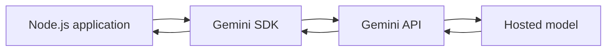
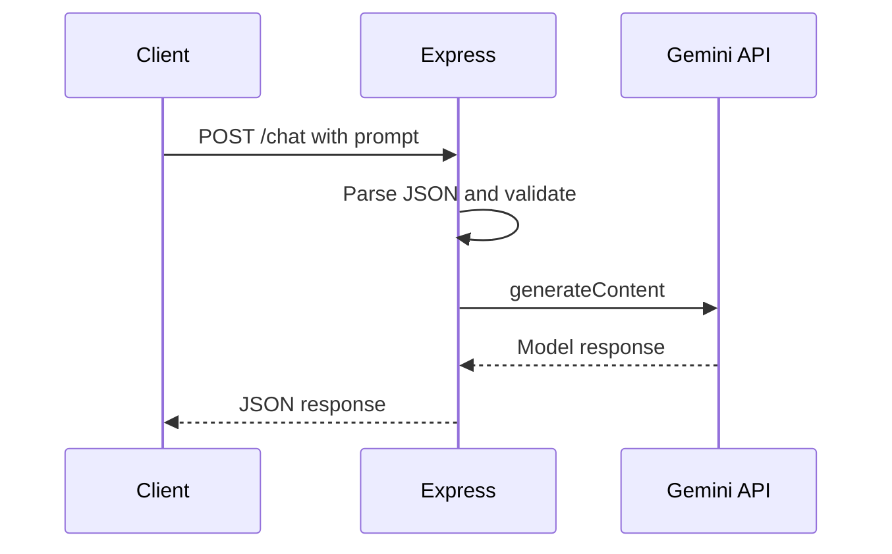

# Week 1 · Class 1 — Building your first LLM-powered backend

**Prerequisites:** JavaScript functions, objects, promises, async/await, Node.js and Express.

## 1. What are we building?

Imagine a study planner that can explain a difficult topic or suggest a revision schedule. Instead of writing a separate explanation for every possible question, our backend sends a prompt to a pretrained language model.

By the end of this class you should be able to call Gemini from Node.js, expose it through a REST API, and replace the native SDK with LangChain.

## 2. AI, generative AI and LLMs

AI is the broad field of building systems that perform tasks associated with intelligence. Generative AI produces new content. A large language model (LLM) is a model trained on large amounts of data to process and generate language.

An LLM predicts tokens based on its input and previously generated tokens. Tokens are pieces of text, not necessarily whole words. The model's learned parameters are not a searchable database of exact facts.

| Term | Meaning | Example |
| --- | --- | --- |
| Model | Trained computational system | Gemini |
| Prompt | Input or instruction | Explain closures |
| Inference | Using a trained model to produce output | Generating an explanation |
| Context | Information supplied to a model for a request | Prompt and earlier messages |
| Hallucination | Plausible but incorrect generated information | Invented library methods |

We are performing inference, not training or fine-tuning a model. A fluent answer is not proof that it is correct.

## 3. API vs SDK vs framework

An API is a contract through which programs communicate. An SDK is a library that provides convenient language-specific methods for working with a service. LangChain is a framework offering abstractions for models, messages and tools.



The SDK does not run Gemini locally. It sends requests over the network. LangChain also uses provider APIs; changing the wrapper does not automatically change the underlying model.

## 4. Set up the classroom project

From the repository root:

```bash
cd studyPlanner
npm ci
```

The existing package.json declares ES modules using "type": "module". That is why the examples use import/export. npm ci installs dependencies according to the lockfile. Use a supported Node.js version compatible with the installed packages.

Create a local .env file in studyPlanner:

```dotenv
GEMINI_API_KEY=your_actual_key_here
GEMINI_MODEL=gemini-3.5-flash-lite
```

The model ID above is the one used in class; select a model actually available to your key if needed. The SDK reads GEMINI_MODEL, but the current LangChain file hardcodes its model. Edit that configuration separately if required.

Never commit a real key. Keep .env and node_modules ignored; use placeholders in .env.example. A browser bundle, even with a frontend environment variable, is visible to users. A leaked key can be abused and incur charges. The server holds the credential and controls access.

## 5. Build a reusable SDK client

Source: [01-sdk-client.js](../../studyPlanner/01-sdk-client.js).

```js
import "dotenv/config";
import { GoogleGenAI } from "@google/genai";

if (!process.env.GEMINI_API_KEY) {
  throw new Error("Missing GEMINI_API_KEY");
}

export const ai = new GoogleGenAI({
  apiKey: process.env.GEMINI_API_KEY,
  httpOptions: { timeout: 15000 },
});

export const model =
  process.env.GEMINI_MODEL || "gemini-3.5-flash-lite";
```

| Code | Why it exists |
| --- | --- |
| import "dotenv/config" | Loads local environment variables into process.env |
| GoogleGenAI | Constructor supplied by Google's SDK |
| if / throw | Stops initialization early if credentials are missing |
| new GoogleGenAI | Configures a reusable client; does not itself generate text |
| apiKey | Authenticates provider requests |
| timeout: 15000 | Configures a 15-second SDK request timeout |
| export | Lets other modules reuse the same client and model ID |
| logical OR | Falls back to the classroom model when the env value is falsy |

Run: node 01-sdk-client.js. Expected: configuration and model initialization logs. This does not prove that the provider accepts your credentials; the next request does.

## 6. Your first model call

Source: [02-first-llmCall.js](../../studyPlanner/02-first-llmCall.js).

```js
import { ai, model } from "./01-sdk-client.js";

async function main() {
  try {
    const prompt = "Explain JavaScript closures in two simple sentences.";
    const result = await ai.models.generateContent({
      model,
      contents: prompt,
    });
    console.log(result.text ?? "(No text returned)");
  } catch (error) {
    console.error("Generation failed:", error.message);
    process.exitCode = 1;
  }
}
main();
```

- async makes main return a promise. await waits for the network result without synchronously blocking the entire Node.js process.
- model selects the hosted model; contents carries the input.
- result is a response object, not just a string. result.text reads generated text.
- ?? falls back only for null or undefined; an empty string is still an empty string.
- try/catch handles rejected requests; exitCode marks CLI failure.

Run: node 02-first-llmCall.js.

Possible output: A closure is a function that remembers variables from its surrounding scope. It can access those variables even after the outer function finishes.

Experiment: ask for the same explanation for a 10-year-old, then for a senior developer. Compare vocabulary and detail. Neither response is guaranteed to be identical across runs.

## 7. Prompt design

A useful prompt specifies task, context, audience, constraints and desired format.

Weak: Explain React.

Better: Explain React state to a student who knows JavaScript. Use a counter example and two short paragraphs. Avoid advanced hooks.

System instructions describe application-wide behaviour; user messages contain the current request. Instructions influence behaviour but do not enforce security or guarantee correctness. Validate outputs if other code relies on them.

## 8. Expose the model through Express

Source: [03-express-server.js](../../studyPlanner/03-express-server.js).



```js
import express from "express";
import { ai, model } from "./01-sdk-client.js";
const app = express();
app.use(express.json());

app.post("/chat", async (req, res) => {
  const { prompt } = req.body ?? {};
  if (typeof prompt !== "string" || !prompt.trim()) {
    return res.status(400).json({ error: "A non-empty prompt is required" });
  }
  try {
    const result = await ai.models.generateContent({ model, contents: prompt });
    return res.json({ response: result.text ?? "" });
  } catch (error) {
    console.error("Gemini call failed:", error.message);
    return res.status(502).json({ error: "AI service failed" });
  }
});
app.listen(process.env.PORT || 8082);
```

express() creates the application; express.json() parses incoming JSON into req.body. Destructuring extracts prompt; the nullish fallback protects against absent bodies. typeof and trim reject non-string and blank inputs. Returning from the validation branch prevents an unnecessary paid model call. res.json serializes the output. A 502 represents an upstream AI service failure in this example.

Run: node 03-express-server.js.

```bash
curl -X POST http://localhost:8082/chat -H 'Content-Type: application/json' -d '{"prompt":"Explain closures simply"}'
```

Illustrative response (200): {"response":"A closure is a function that remembers its surrounding variables."}

Try an empty prompt, a numeric prompt, and a missing prompt. Each should return 400. A valid request with failed provider authentication should reach the catch block and return 502 if initialization succeeds.

## 9. Migrate to LangChain

Source: [04-LangChain.js](../../studyPlanner/04-LangChain.js).

```js
import "dotenv/config";
import { ChatGoogle } from "@langchain/google";

export const model = "gemini-3.5-flash-lite";
export const llm = new ChatGoogle({
  model,
  apiKey: process.env.GEMINI_API_KEY,
  temperature: 0.2,
  maxOutputTokens: 200,
});
```

The original file also checks for GEMINI_API_KEY. Its error text says GOOGLE_API_KEY, but the actual checked variable is GEMINI_API_KEY.

ChatGoogle is the provider integration. temperature influences sampling variability: lower values generally produce more consistent output, not necessarily more accurate output. maxOutputTokens limits generated tokens, not input length or word count; short limits can truncate an answer.

Source: [05-LanchainChat.js](../../studyPlanner/05-LanchainChat.js).

Inside the same validated Express route, replace the SDK invocation with:

```js
const result = await llm.invoke(prompt);
const answer = result.text ?? "";
return res.json({ response: answer });
```

invoke sends an input through the model abstraction and returns an AI message. The message can carry content and metadata, not merely plain text.

| Native SDK | LangChain |
| --- | --- |
| GoogleGenAI | ChatGoogle |
| ai.models.generateContent({ model, contents }) | llm.invoke(prompt) |
| Provider-specific response | AI message abstraction |
| Direct provider integration | Common abstractions useful for tools and agents |

Run node 05-LanchainChat.js; default port is 8083. The filename spelling is intentional here because it matches the repository.

```bash
curl -X POST http://localhost:8083/chat -H 'Content-Type: application/json' -d '{"prompt":"Explain async await in two lines"}'
```

## 10. Does the chatbot remember?

The endpoint sends only the current prompt. If you ask "My name is Alex" and then "What is my name?" in separate requests, no previous message is supplied by this code. The model is not automatically a persistent conversation store. History must be explicitly managed and supplied; that is outside this week's implementation.

## 11. Debugging and production awareness

| Symptom | Check |
| --- | --- |
| ERR_MODULE_NOT_FOUND | Run npm ci in studyPlanner |
| Missing key | .env location and GEMINI_API_KEY spelling |
| Model not found | Available provider model and configured ID |
| EADDRINUSE | Stop the other server or change PORT |
| 400 | JSON header and non-empty string prompt |
| 502 | Server logs, provider quota, credentials and network |
| Empty response | Output limit, safety blocks or response shape |

The comments in several source files reference older sections/ paths and ports; use the actual filenames and ports in these notes. Classroom routes may return an empty string with status 200; the assignment contract instead requires handling empty answers as upstream failures. Real services also need authentication, rate limits, request size limits, timeouts, monitoring and careful log redaction. Do not expose provider error details or secrets.

## 12. Revision questions

1. Why is an SDK not an LLM?
2. Why should keys stay in the backend?
3. What happens while await is waiting?
4. How are input tokens and output tokens different?
5. Why can low temperature still produce incorrect answers?
6. What is the difference between a 400 and a 502?
7. Does switching to LangChain give the application memory?

Practice: run both API implementations and compare their response contracts. Do not solve the assignments by copying an unrelated application.

Next: [Agents and tools](02-agents-and-tools.md) · [Week 1 assignments](../../assignments/week-1/README.md).
