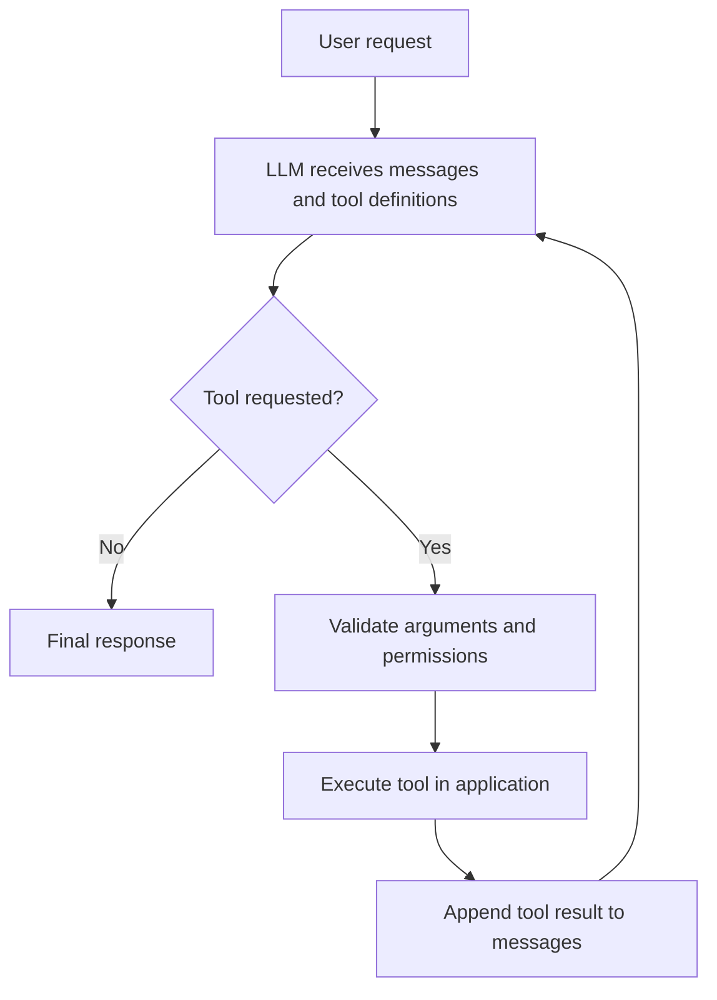
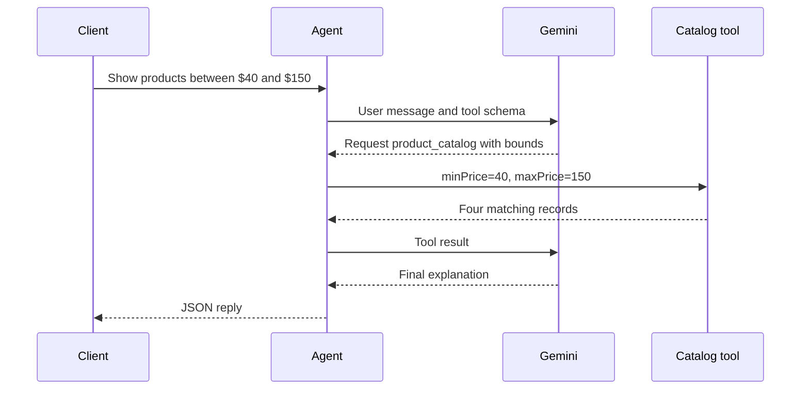

# Week 1 · Class 2 — AI agents, web search and custom tools

**Before starting:** Complete [Class 1](01-llm-fundamentals.md). You should know how to initialize a model and build a POST /chat route.

## 1. Why an LLM alone is not enough

Suppose you ask a chatbot for today's news, or whether a product in your store is in stock. A plain model call cannot automatically access the internet or your private catalog. It may guess. We need to provide the application with tools.

An LLM generates or processes language. An agent is a system that uses a model to choose actions, executes permitted tools, observes their results and continues until it returns an answer or reaches a limit.

| Plain LLM call | Tool-enabled agent |
| --- | --- |
| Prompt in, generated message out | Goal in, potentially multiple model/tool interactions |
| No external access by default | Can access explicitly provided tools |
| Good for explanations and writing | Useful for research and application-specific data |
| Often one model request | Can involve multiple requests, latency and costs |

An agent is not a new type of trained model. It is an application architecture around a model. A fixed workflow decides the steps in advance; an agent can choose among available steps. Not every problem needs an agent.

## 2. Agent execution loop



A tool call is a structured request from the model, not execution itself. The runtime executes the function and returns the result to the model. The model may request another tool or produce a final answer. A tool is not another LLM by definition: it may be a search API, database read, or ordinary JavaScript function.

Illustrative message sequence:

```text
Human: What is the latest release of a library?
AI: requests web search with relevant keywords
Tool: returns results with URLs and snippets
AI: summarizes results and cites relevant links
```

These are observable messages/actions, not a transcript of hidden model reasoning.

## 3. Setup

From repository root:

```bash
cd agents
npm ci
```

Create agents/.env with placeholders replaced locally:

```dotenv
GEMINI_API_KEY=your_gemini_key
TAVILY_API_KEY=your_tavily_key
```

The custom catalog demo needs Gemini but does not use Tavily. The search demo needs both. [04-LangChain.js](../../agents/04-LangChain.js) initializes ChatGoogle with the same classroom model, temperature 0.2 and maxOutputTokens 200. Use an accessible model and raise the output limit if longer tool-based answers are being truncated.

## 4. Built-in tool: Tavily

Source: [langChainLLM.js](../../agents/langChainLLM.js).

Tavily is an external search service designed to return information that AI applications can consume. It is not the language model, and search results are not guaranteed to be correct.

```js
import { TavilySearch } from "@langchain/tavily";
import { createAgent } from "langchain";
import { llm } from "./04-LangChain.js";

const searchTool = new TavilySearch({
  maxResults: 5,
  topic: "general",
});
```

maxResults configures the requested result limit per search, not the number of tool calls. topic selects the general search category. The search integration uses its own credential. The model receives the tool definition and can request a search.

## 5. Build a search-enabled agent

The classroom code configures createAgent:

```js
const agent = createAgent({
  model: llm,
  tools: [searchTool],
  systemPrompt: "Use search for current facts; answer from results and cite sources. Do not guess.",
});
```

The system prompt above is abbreviated for revision. The actual source also instructs the agent to avoid unnecessary searches, formulate concise queries, refine weak results up to three times and acknowledge uncertainty.

model is the language engine; tools is an array of capabilities; systemPrompt gives behavioural guidance. A prompt saying "up to three times" is not a hard execution limit. Production code must enforce request, iteration, time and cost limits separately.

Within the Express handler:

```js
const result = await agent.invoke({
  messages: [{ role: "user", content: prompt }],
});
return res.send(result.messages.at(-1).content);
```

invoke accepts message state rather than a single string here. role distinguishes message origin; content holds the user's text. result.messages contains the interaction history for this invocation. at(-1) reads the last item. In normal successful runs this is the final AI message. Content can be structured blocks, so robust code checks message type and extracts text rather than assuming content is a string.

The classroom file uses res.send, whereas assignments require a JSON object with a non-empty response string. Do not confuse the two contracts.

Run node langChainLLM.js from agents. Default port: 8083.

```bash
curl -X POST http://localhost:8083/chat -H 'Content-Type: application/json' -d '{"prompt":"Find the latest stable Node.js release and cite the official source"}'
```

Expected behaviour: search for current information, use relevant results and include a source. No fixed version is provided here because it changes.

Try "Explain a JavaScript closure" and compare tool usage. The agent should generally answer without search. Inspect tool-call logs/messages rather than inferring tool usage merely from fluent answers.

## 6. Custom tool: the shopping catalog

Source: [customAgent.js](../../agents/customAgent.js).

This independent demo gives the agent access to a six-item in-memory catalog. It does not connect to Tavily or a real store database.

| Product (short name) | Category | Price USD |
| --- | --- | ---: |
| Mechanical Keyboard | Electronics | 129.99 |
| Water Bottle | Home & Outdoors | 34.50 |
| Merino Sweater | Apparel | 98.00 |
| Coffee Dripper | Kitchen | 46.00 |
| Mesh Task Chair | Furniture | 279.00 |
| Sling Bag | Accessories | 68.00 |

The model should not invent prices. JavaScript determines which products match, and the model presents the results conversationally.

## 7. Understand the filtering function

```js
function filterProducts({ productName, query, category, minPrice, maxPrice }) {
  const searchTerm = (query || productName || "").trim().toLowerCase();

  return products.filter((p) => {
    const matchesText =
      !searchTerm ||
      p.name.toLowerCase().includes(searchTerm) ||
      p.category.toLowerCase().includes(searchTerm) ||
      p.brand.toLowerCase().includes(searchTerm) ||
      p.description.toLowerCase().includes(searchTerm) ||
      p.tags.some((tag) => tag.toLowerCase().includes(searchTerm));

    const matchesCategory =
      !category || p.category.toLowerCase() === category.trim().toLowerCase();

    const matchesMin = minPrice === undefined || p.price >= minPrice;
    const matchesMax = maxPrice === undefined || p.price <= maxPrice;
    return matchesText && matchesCategory && matchesMin && matchesMax;
  });
}
```

- Destructuring extracts optional properties. query takes precedence over productName when truthy.
- trim and toLowerCase normalize the input. includes performs substring matching, not semantic search.
- filter creates an array of matching products. some checks whether any tag contains the keyword.
- The OR conditions allow omitted filters; explicit category matching is case-insensitive but exact.
- undefined checks preserve zero as a valid price bound. >= and <= make the range inclusive.
- The final AND requires all active filters to pass.

Dry run for { minPrice: 40, maxPrice: 150 }: keyboard, sweater, dripper and sling bag pass. Bottle is below the minimum, chair exceeds the maximum. This is deterministic even when the model's wording varies.

## 8. Zod and tool schemas

Source imports:

```js
import { tool } from "@langchain/core/tools";
import { z } from "zod";
```

Zod is a runtime schema validation library. A schema describes the structure and types of the arguments expected by a tool. JavaScript alone does not validate external objects automatically.

```js
const schema = z.object({
  productName: z.string().optional().describe("Exact or partial product name"),
  query: z.string().optional().describe("Keyword"),
  category: z.string().optional().describe("Category name"),
  minPrice: z.number().nonnegative().optional().describe("Minimum USD price"),
  maxPrice: z.number().nonnegative().optional().describe("Maximum USD price"),
});
```

z.object expects an object; z.string and z.number describe types; optional permits omission/undefined; nonnegative rejects negative values; describe supplies useful metadata for the model and developers. A numeric string such as "40" is not a number under this schema.

A schema does not express every business rule automatically. Both prices may be valid numbers but the range is invalid if the minimum exceeds the maximum.

## 9. Register a tool

The following teaching excerpt uses the schema and filter defined above; the repository defines the schema inline and includes fuller descriptions.

```js
const productTool = tool(
  async (input) => {
    console.log("Custom Tool Called:", input);
    if (
      input.minPrice !== undefined &&
      input.maxPrice !== undefined &&
      input.minPrice > input.maxPrice
    ) {
      return JSON.stringify({ error: "Invalid price range" });
    }

    const matches = filterProducts(input);
    if (!matches.length) {
      return JSON.stringify({
        count: 0, products: [], message: "No products matched your criteria.",
      });
    }
    return JSON.stringify({ count: matches.length, products: matches });
  },
  {
    name: "product_catalog",
    description: "Search store products by keyword, category or inclusive USD price range.",
    schema,
  }
);
```

The first argument is the function the runtime executes. The second describes it to the agent. A clear name and description help the model select it correctly. JSON.stringify returns serialized data that the runtime can supply to the model. Logging lets us verify execution, but do not log sensitive arguments in production.

A zero-match result is valid, not a system failure. A reversed price range is a business-rule error. Neither should lead to invented products.

## 10. Connect the custom tool to the agent

```js
const agent = createAgent({
  model: llm,
  tools: [productTool],
  systemPrompt: "Use product_catalog for store questions. Pass both price bounds when provided. Use USD and only state facts returned by the tool.",
});
```

The actual system prompt in customAgent.js is more detailed. The route validates prompt, invokes the agent with one user message, then reads the last message:

```js
const reply = result.messages.at(-1)?.content ?? "";
return res.json({ reply });
```

Optional chaining protects against a missing final element. The nullish fallback does not validate empty text or structured content. The classroom response key is reply; assignments standardize on response.



Stop the search demo before starting node customAgent.js because both use port 8083 by default.

```bash
curl -X POST http://localhost:8083/chat -H 'Content-Type: application/json' -d '{"prompt":"Show me products between $40 and $150"}'
```

Expected facts: four matching items at $129.99, $98, $46 and $68. The agent may order them differently. The terminal should show Custom Tool Called with the chosen arguments.

## 11. Test matrix

| Request | What to verify |
| --- | --- |
| Show products between $40 and $150 | Both bounds passed; four matches |
| Electronics under $150 | Correct category and one match |
| Products under $10 | No matches, no invented products |
| Products from $150 to $40 | Clear range error or clarification, not fabricated results |
| Show products at exactly $46 | Inclusive bounds; coffee dripper |
| Blank prompt | HTTP 400 before model invocation |
| Provider unavailable | HTTP 502 if invocation fails |

Test the pure filter independently from the model where possible. Tool selection and generated wording can vary; test factual correctness and actual tool arguments. The current classroom code does not provide an automated test suite.

## 12. Important limitations and safe design

Search data is untrusted and may contain misleading information or prompt injection (text attempting to override the application's instructions). Treat it as data; verify sources. Never send secrets to a search tool. Validate tool arguments and enforce authorization in backend code, not only in a system prompt.

The catalog is static and prices are USD; image URLs are placeholders. No live inventory, purchasing or currency conversion is implemented. The filter does not filter by stock, ratings or sort order. Do not promise those capabilities. There is no persistent memory across requests. Keep tools read-only unless the application implements appropriate permissions and explicit safeguards.

Use deterministic code for calculations and exact filtering; use the model for interpreting language and presenting results. Multiple tools can be supplied in an array, but the two classroom agents intentionally demonstrate separate capabilities. The later assignments ask you to design your own combinations.

## 13. Revision and viva

1. Can a plain LLM automatically read your MongoDB database? Why?
2. Who actually executes a tool call?
3. What is the difference between Tavily and Gemini?
4. Why do we pass a tool schema to the model?
5. What is the difference between schema validation and business validation?
6. Why do we check undefined instead of using !minPrice?
7. Why can an agent be more expensive than a single model call?
8. How can you prove the tool was really called?
9. Does a system prompt guarantee search iteration limits?
10. Why should exact calculations happen in JavaScript?

## 14. Apply your understanding

The six [Week 1 assignments](../../assignments/week-1/README.md) progress from direct model calls through LangChain, search, custom tools and multiple-tool applications. Read each problem's guide and implement independently. These notes explain classroom examples, not assignment solutions.

[Back to notes index](../README.md).
